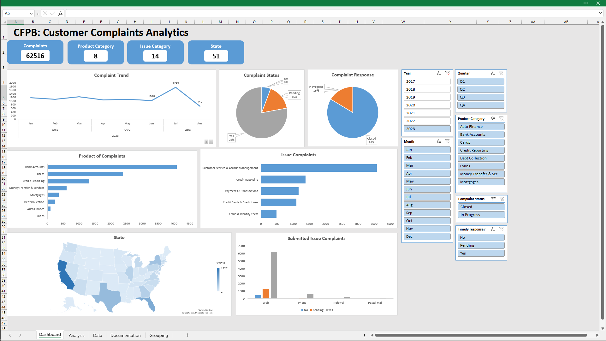
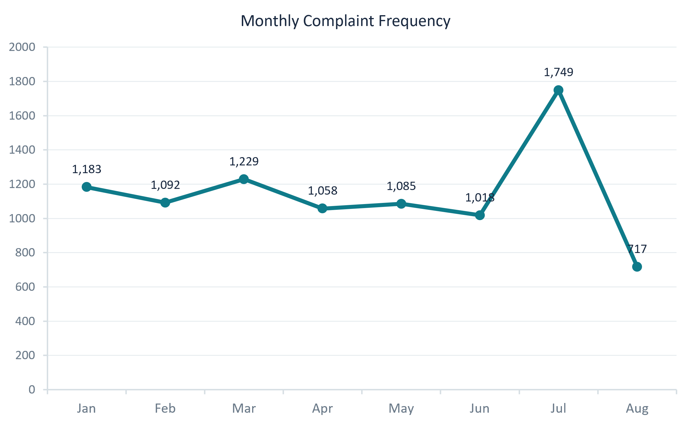

# Consumer Financial Protection Bureau (CFPB): Financial Consumer Complaints Analytics

An end-to-end data analytics project using Microsoft Excel to analyze Bank of America's consumer complaints from 2017 to 2023. The project aims to identify complaint trends, understand recurring financial product issues, evaluate company response patterns, and provide actionable recommendations to improve customer experience and operational performance.

# Project Background

Bank of America operates in the financial services industry, serving consumers through various financial products, including checking and savings accounts, credit cards, mortgages, and loans.

As a financial institution, the company must manage consumer complaints submitted through the Consumer Financial Protection Bureau (CFPB). Analyzing these complaints provides an opportunity to understand customer dissatisfaction, identify recurring issues, and evaluate the company's complaint-handling performance.

This project analyzes consumer complaints submitted between 2017 and 2023 to identify patterns and potential operational gaps.

**The analysis focuses on four key areas:**

- **Complaint Trends:** Identify annual, quarterly, and monthly complaint patterns.
- **Product and Issue Analysis:** Determine which financial products and issues generate the highest complaint volumes.
- **Company Response Analysis:** Evaluate how the company responds to and resolves consumer complaints.
- **Response Timeliness:** Investigate patterns associated with untimely company responses.

**Analytical Questions:**

1. Do consumer complaints show seasonal or temporal patterns?
2. Which financial products generate the most complaints, and what are their most common issues?
3. How are consumer complaints typically handled and resolved?
4. What insights can be identified from complaints with untimely responses?

**Tools:** Microsoft Excel

**Dataset:** [Financial Consumer Complaints – Maven Analytics](https://mavenanalytics.io/data-playground/financial-consumer-complaints)

**Data Source:** Consumer Financial Protection Bureau (CFPB)

**Analysis Period:** 2017–2023

# Data Structure & Initial Checks

The dataset contains consumer complaint records associated with Bank of America, including submission information, consumer locations, financial products, reported issues, and company responses.

The dataset includes the following key attributes:

- **Complaint ID:** Unique identification number for each complaint.
- **Submitted via:** Channel used to submit the complaint.
- **Date submitted:** Date the CFPB received the complaint.
- **Date received:** Date the CFPB sent the complaint to the company.
- **State:** Consumer's reported state.
- **Product and Sub-product:** Financial product associated with the complaint.
- **Issue and Sub-issue:** Specific problems reported by consumers.
- **Company public response:** Company's optional public-facing response.
- **Company response to consumer:** Company's response or resolution description.
- **Timely response?:** Indicates whether the company provided a timely response (Yes/No).

**Initial Data Quality Checks:**

- Duplicate complaint IDs and records.
- Date format and chronological consistency.
- Missing values in sub-product, sub-issue, and response-related columns.
- Consistency of categorical values.
- Completeness of company response descriptions.
- Missing and inconsistent timely response indicators.

**Data Preparation:**

Data cleaning and transformation were performed using Microsoft Excel. The preparation process included:

- Checking and removing confirmed duplicate records.
- Standardizing categorical values.
- Handling missing values in relevant columns.
- Extracting Year, Month, and Quarter from submission dates.
- Creating Product Category and Issue Category.
- Calculating the interval between CFPB complaint receipt and company referral.
- Creating derived complaint status classifications based on documented response rules.

The prepared dataset supports temporal analysis, product comparisons, issue classification, geographical analysis, and company response evaluation.

# Executive Summary

### Overview of Findings

[Summarize the three most important findings from the analysis in 2–3 sentences. Highlight the most significant complaint trends, dominant financial products or issues, and company response performance.]

# Insights Deep Dive

### 1. Complaint Trends

- **Main Insight 1:** Describe the annual complaint distribution and identify significant increases or decreases.
- **Main Insight 2:** Identify monthly or quarterly complaint patterns.
- **Main Insight 3:** Highlight periods with unusually high complaint volumes.
- **Main Insight 4:** Explain potential business implications of the observed trends.

### 2. Product and Issue Analysis

- **Main Insight 1:** Identify the financial products with the highest complaint volumes.
- **Main Insight 2:** Examine the most frequently reported issues within each major product.
- **Main Insight 3:** Identify recurring customer dissatisfaction patterns.
- **Main Insight 4:** Explain which products and issues require greater attention.

[Product and Issue Visualizations]

### 3. Company Response Analysis

- **Main Insight 1:** Analyze the distribution of company response types.
- **Main Insight 2:** Identify the most common complaint resolution outcomes.
- **Main Insight 3:** Compare response patterns across financial products.
- **Main Insight 4:** Highlight potential gaps in complaint-handling practices.

[Company Response Visualizations]

### 4. Timely Response Analysis

- **Main Insight 1:** Evaluate the proportion of timely and untimely responses.
- **Main Insight 2:** Identify products associated with higher untimely response counts.
- **Main Insight 3:** Compare untimely responses across reported issues and states.
- **Main Insight 4:** Identify potential operational bottlenecks and areas for improvement.

[Timely Response Visualizations]

# Recommendations

Based on the analytical findings, the following recommendations are intended for Bank of America's Customer Experience, Compliance, and Operations teams:

- **Complaint Monitoring:** Establish regular monitoring of complaint volumes to identify unusual increases and emerging customer concerns.
- **Product Improvement:** Prioritize financial products and recurring issues that contribute the highest complaint volumes.
- **Resolution Quality:** Review common complaint resolution outcomes to identify opportunities to improve customer satisfaction and resolution practices.
- **Response Efficiency:** Investigate products and operational areas associated with higher untimely response rates.
- **Performance Monitoring:** Develop a complaint monitoring dashboard to track complaint volume, response timeliness, and resolution patterns.

# Assumptions and Caveats

- The analysis covers Bank of America consumer complaints submitted between 2017 and 2023.
- Missing sub-product and sub-issue values are classified as `Not specified`, as not all products and issues require additional classifications.
- Missing company public responses are classified as `No public response provided`. This does not necessarily indicate that the company failed to respond directly to the consumer.
- The difference between `Date received` and `Date submitted` represents the interval between CFPB receipt and company referral, not the actual company response time.
- Complaint status classifications are based on documented rules applied to the available response descriptions and should not be interpreted as independently verified resolution outcomes.
- Complaint volume represents reported complaints, not necessarily the overall level of customer dissatisfaction among all Bank of America customers.
- Observed relationships and patterns do not establish causation.
