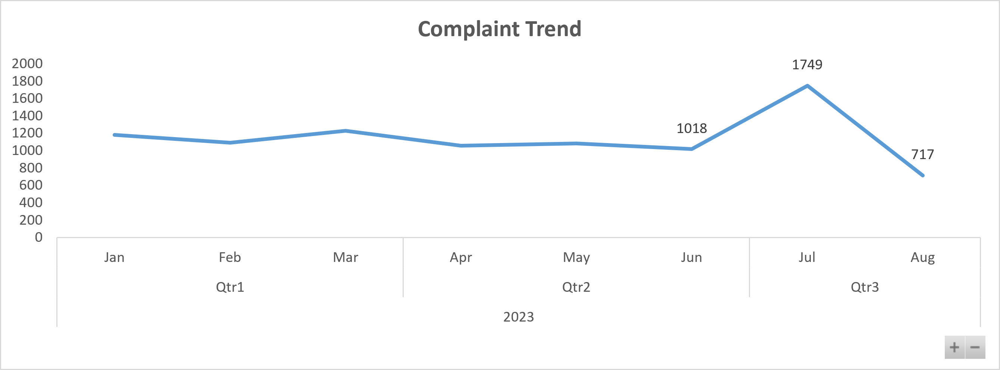
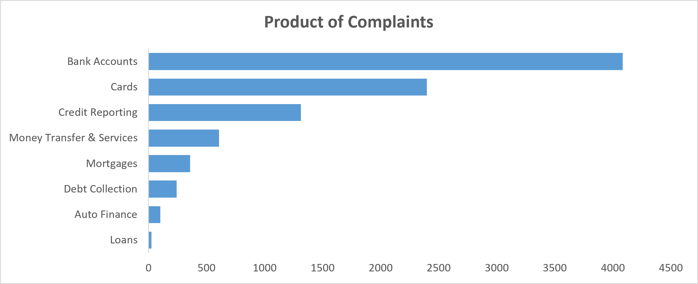
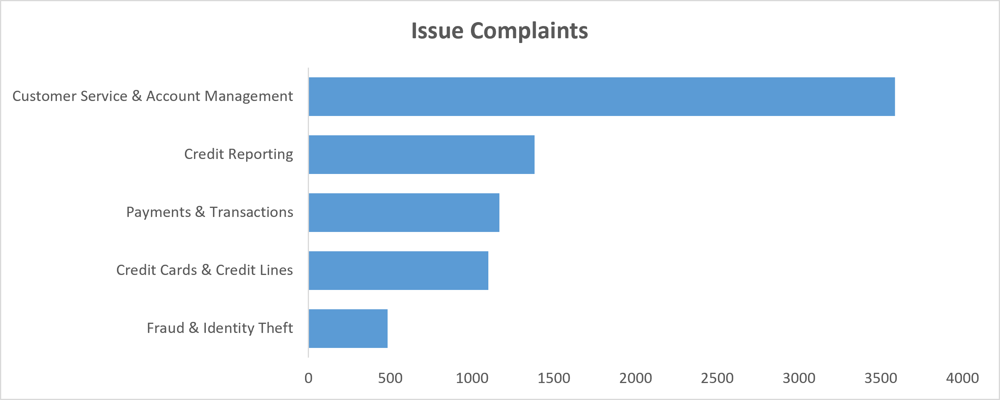
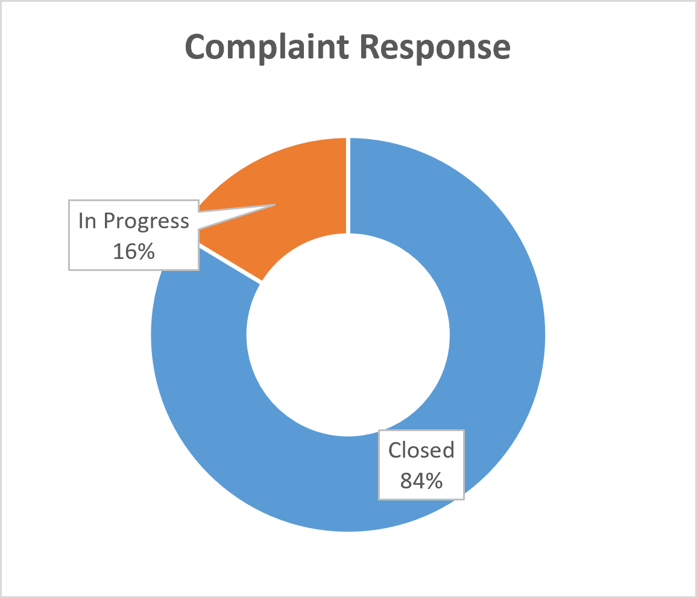
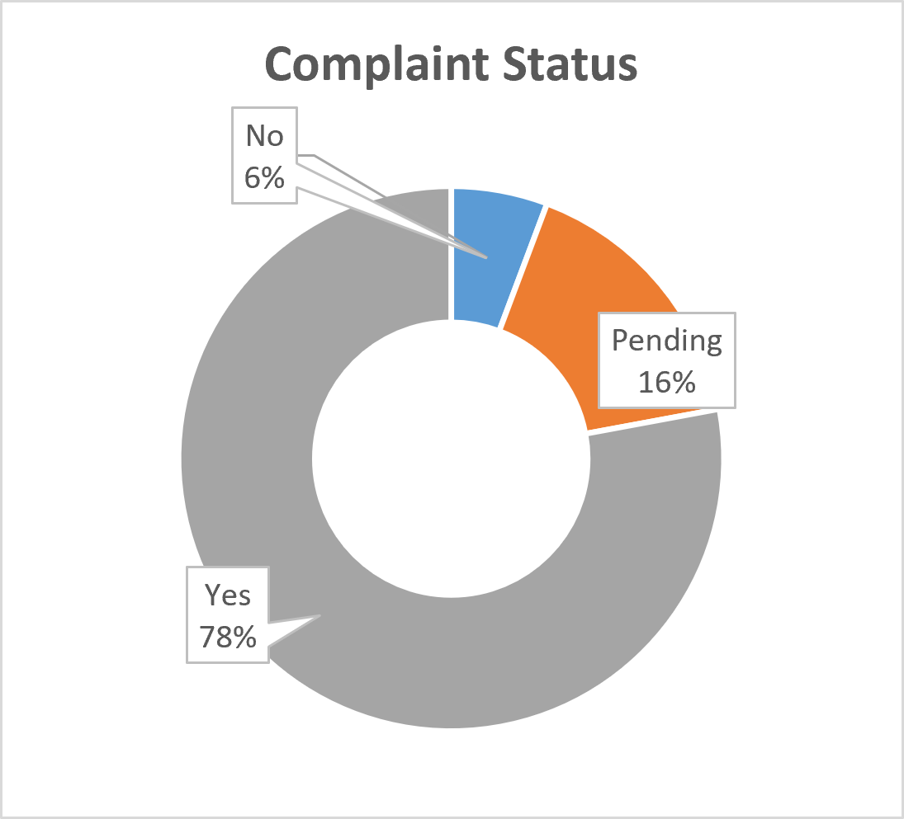
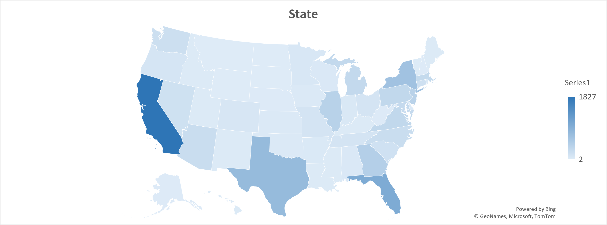

# Consumer Financial Protection Bureau (CFPB): Financial Consumer Complaints Analytics

An end-to-end data analytics project using Microsoft Excel to analyze Bank of America's consumer complaints from 2017 to 2023. The project aims to identify complaint trends, understand recurring financial product issues, evaluate company response patterns, and provide actionable recommendations to improve customer experience and operational performance.

# Project Background

Bank of America operates in the financial services industry, serving consumers through various financial products, including checking and savings accounts, credit cards, mortgages, and loans.

As a financial institution, the company must manage consumer complaints submitted through the Consumer Financial Protection Bureau (CFPB). Analyzing these complaints provides an opportunity to understand customer dissatisfaction, identify recurring issues, and evaluate the company's complaint-handling performance.

This project analyzes consumer complaints submitted between 2017 and 2023 to identify patterns and potential operational gaps.

**The analysis focuses on four key areas:**

- **Complaint Trends:** Identify annual, quarterly, and monthly complaint patterns.
- **Product and Issue Analysis:** Determine which financial products and issues generate the highest complaint volumes.
- **Company Response Analysis:** Evaluate how the company responds to and resolves consumer complaints.
- **Response Timeliness:** Investigate patterns associated with untimely company responses.

**Analytical Questions:**

1. Do consumer complaints show seasonal or temporal patterns?
2. Which financial products generate the most complaints, and what are their most common issues?
3. How are consumer complaints typically handled and resolved?
4. What insights can be identified from complaints with untimely responses?

**Tools:** Microsoft Excel

**Dataset:** [Financial Consumer Complaints – Maven Analytics](https://mavenanalytics.io/data-playground/financial-consumer-complaints)

**Data Source:** Consumer Financial Protection Bureau (CFPB)

**Analysis Period:** 2017–2023

# Data Structure & Initial Checks

The dataset contains consumer complaint records associated with Bank of America, including submission information, consumer locations, financial products, reported issues, and company responses.

The dataset includes the following key attributes:

- **Complaint ID:** Unique identification number for each complaint.
- **Submitted via:** Channel used to submit the complaint.
- **Date submitted:** Date the CFPB received the complaint.
- **Date received:** Date the CFPB sent the complaint to the company.
- **State:** Consumer's reported state.
- **Product and Sub-product:** Financial product associated with the complaint.
- **Issue and Sub-issue:** Specific problems reported by consumers.
- **Company public response:** Company's optional public-facing response.
- **Company response to consumer:** Company's response or resolution description.
- **Timely response?:** Indicates whether the company provided a timely response (Yes/No).

**Initial Data Quality Checks:**

- Duplicate complaint IDs and records.
- Date format and chronological consistency.
- Missing values in sub-product, sub-issue, and response-related columns.
- Consistency of categorical values.
- Completeness of company response descriptions.
- Missing and inconsistent timely response indicators.

**Data Preparation:**

Data cleaning and transformation were performed using Microsoft Excel. The preparation process included:

- Checking and removing confirmed duplicate records.
- Standardizing categorical values.
- Handling missing values in relevant columns.
- Extracting Year, Month, and Quarter from submission dates.
- Creating Product Category and Issue Category.
- Calculating the interval between CFPB complaint receipt and company referral.
- Creating derived complaint status classifications based on documented response rules.

The prepared dataset supports temporal analysis, product comparisons, issue classification, geographical analysis, and company response evaluation.

# Executive Summary

### Overview of Findings

Between January and August 2023, total complaint volume reached 9,131 cases, remaining stable at 1,000–1,200 monthly complaints before experiencing a sharp 71.8% spike in July (1,749 cases) and subsequently dropping to a period low of 717 cases in August. The primary driver of customer friction is concentrated in Bank Accounts (4,085 complaints) and Customer Service & Account Management (3,586 complaints), with California, Florida, Texas, and New York accounting for over 46% of all submissions. Overall company performance remains strong with an 83.6% closure rate and 78% timely response rate, though Web submissions and Bank Account issues represent the highest absolute volume of delayed responses.

# Insights Deep Dive

### 1. Complaint Trends

- **Core Trend:** Complaint volume remained relatively stable between 1,000 and 1,200 per month across Q1 and Q2 2023.

- **Peak Spike:** July 2023 saw an unusual surge, peaking at 1,749 complaints a **71.8% increase** from June (1,018 complaints).

- **Sharp Drop:** Following the July peak, volume dropped by **59.0%** in August 2023 down to 717 complaints, hitting the lowest point of the period observed.

### 2. Most Complained-About Products

- **Largest Untimely Volume:** **Bank Accounts** recorded the highest raw count of untimely responses ("No") at **256 complaints**, representing **49.0%** of all non-timely cases (256 out of 522).

- **Highest Untimely Rate (Proportional Risk):** While low in total volume, **Loans** has the highest untimely response rate at **11.5%** (3 out of 26), followed by **Debt Collection** at **6.2%** (15 out of 243) and **Bank Accounts** at **6.3%** (256 out of 4,085).

- **Highest On-Time Resolution:** **Mortgages** achieved the highest timely response rate ("Yes") at **86.4%** (310 out of 359), closely followed by **Money Transfer & Services** at **83.5%** (507 out of 607).

### 3. Issue Complaints

- **Highest Untimely Volume:** **Customer Service & Account Management** accounts for the highest raw count of untimely responses ("No") with **217 complaints**, representing **42.5%** of all non-timely cases (217 out of 510).

- **Highest Relative Untimely Risk:** **Bank Accounts & Overdrafts** has the highest proportion of untimely responses at **8.5%** (15 out of 177), followed by **Credit Reporting** at **7.1%** (98 out of 1,382) and **Debt Collection** at **6.3%** (13 out of 207).

- **Highest Timely Resolution:** **Mortgages & Home Loans** achieved the highest timely response rate ("Yes") at **83.2%** (153 out of 184), whereas **Bank Accounts & Overdrafts** had the lowest at **62.1%** (110 out of 177).

### 4. Company Response Performance

- **High Resolution Rate:** The vast majority of complaints (**84%**) have been resolved and closed.

- **Active Backlog:** A minority share of **16%** of complaints remain actively in progress..

### 5. Timely Response Rate

- **Majority Timely Resolved:** The vast majority (**78%**) of complaints have been answered/resolved in a timely manner ("Yes").

- **Pending Workload:** **16%** of complaints are currently pending resolution ("Pending").

- **Untimely Responses:** A small fraction of **6%** were not addressed in a timely manner ("No").

### 6. Geographic Distribution

- **Top Volume States:** **California (CA)** leads by a massive margin with **1,827 complaints** (20.0% of total volume), followed by **Florida (FL)** with **995**, **Texas (TX)** with **749**, and **New York (NY)** with **633**.

- **Geographic Concentration:** The top 4 states combined account for **4,204 complaints** (over **46%** of the 9,131 grand total), showing high concentration in heavily populated states.

- **Low Volume States:** States like **South Dakota (SD)** and **Wyoming (WY)** recorded the lowest counts with just **2 complaints** each.

### 6. Submitted Via Complaints

| Channel         |   No    | Pending  |   Yes    |  Total   |
| :-------------- | :-----: | :------: | :------: | :------: |
| **Web**         |   473   |   1303   |   6188   |   7964   |
| **Phone**       |   29    |   132    |   615    |   776    |
| **Referral**    |   17    |    51    |   247    |   315    |
| **Postal mail** |    3    |    8     |    65    |    76    |
| **Total**       | **522** | **1494** | **7115** | **9131** |

- **Dominant Channel:** **Web** is the primary submission method, accounting for **7,964 complaints** (**87.2%** of total volume).
- **Highest Untimely Risk:** **Web** also generates the highest rate of non-timely responses ("No"), representing **90.6%** (473 out of 522) of all untimely complaints across channels.
- **Consistent Timeliness across Channels:** Overall timeliness ("Yes") remains high at around **77% to 85%** across all submission methods, with **Postal mail** showing the highest timeliness rate (**85.5%**).

Here is the tailored draft formatted cleanly for your presentation or final report document:

---

# Recommendations

Based on the analytical findings, the following strategic actions are recommended for Bank of America's Customer Experience, Compliance, and Operations teams:

- **Complaint Monitoring:** Establish automated early-warning monitoring of monthly complaint volumes to quickly detect unusual spikes and emerging customer pain points.

- **Product & Issue Improvement:** Focus quality improvement initiatives directly on **Bank Accounts** and **Customer Service & Account Management**, which drive the vast majority of total customer friction.

- **Resolution Quality:** Audit common resolution outcomes to enhance customer satisfaction, refine internal practices, and lower the backlog of pending cases.

- **Response Efficiency:** Investigate operational bottlenecks within **Web submission channels** and **high-risk products/issues** to eliminate delayed, untimely responses.

- **Performance Dashboarding:** Build an interactive tracking dashboard to monitor real-time complaint trends, channel-level timeliness, state distributions, and resolution performance.

---

# Assumptions and Caveats

- **Timeframe Coverage:** The underlying dataset covers Bank of America consumer complaints submitted from 2017 through 2023.

- **Unspecified Classifications:** Missing sub-product and sub-issue entries are categorized as `Not specified`, reflecting instances where sub-classifications were not applicable or reported.
- **Public Responses:** Missing company public responses are recorded as `No public response provided`, which indicates an absence of public commentary rather than a failure to respond directly to the consumer.
- **Submission Intervals:** The duration between `Date received` and `Date submitted` measures the transmission interval from CFPB receipt to company referral, not the company's internal handling time.
- **Status Rules:** Complaint status classifications are based on standardized rule mappings of response descriptions rather than independently audited outcome verifications.
- **Sample Representativeness:** Complaint counts represent formal CFPB filings and serve as a proxy for customer friction rather than a census of total customer dissatisfaction across all accounts.

- **Analytical Scope:** Observed correlations and patterns highlight operational focus areas but do not inherently prove direct causality.
